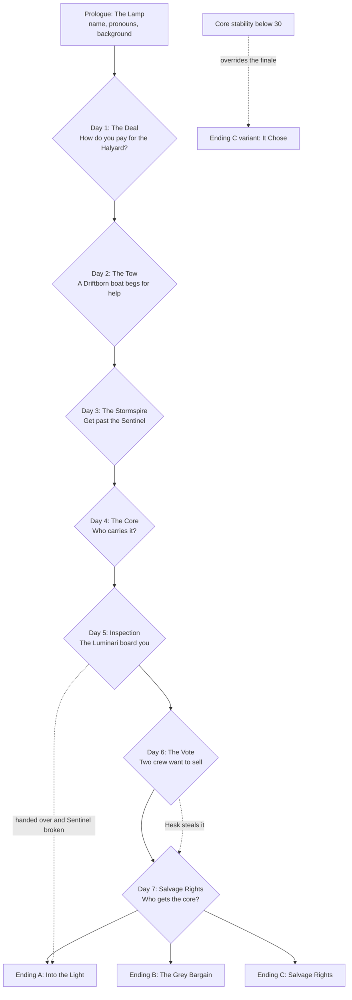
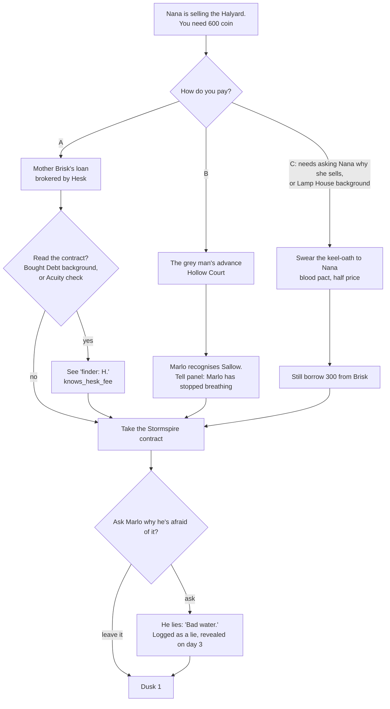
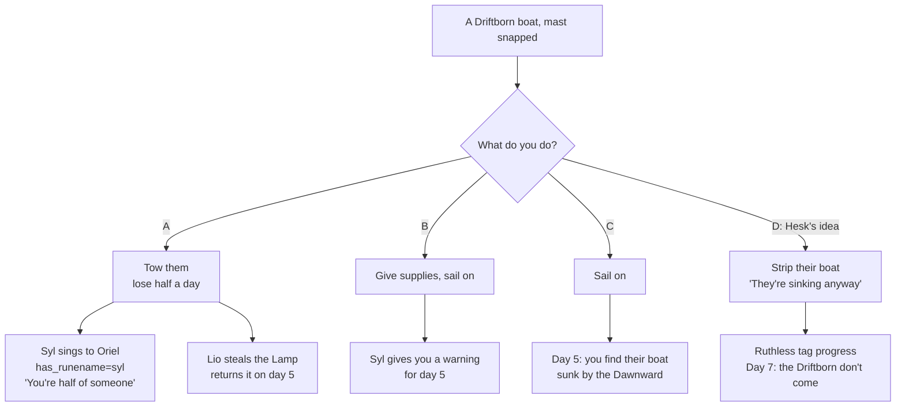
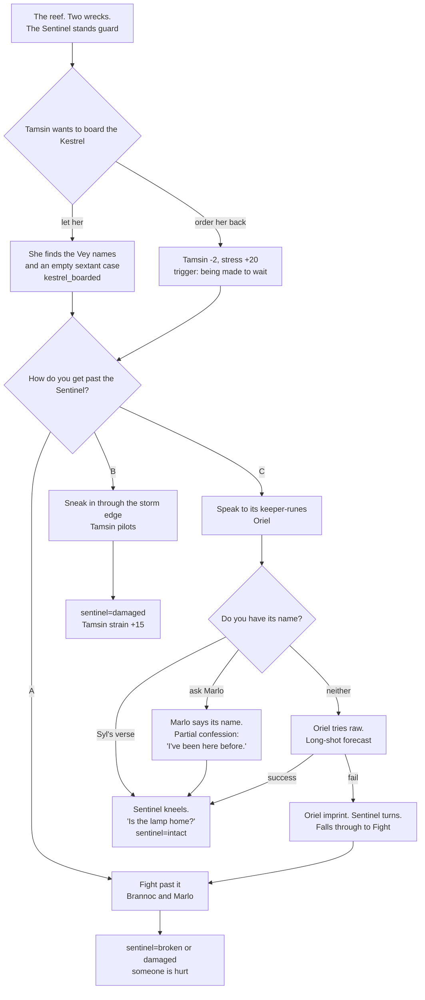
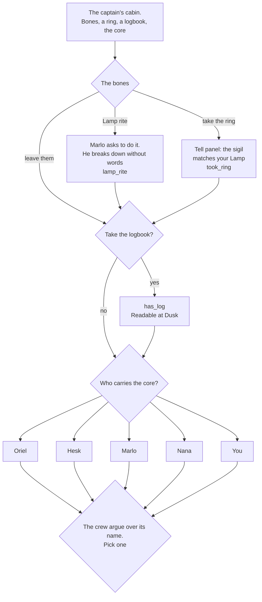
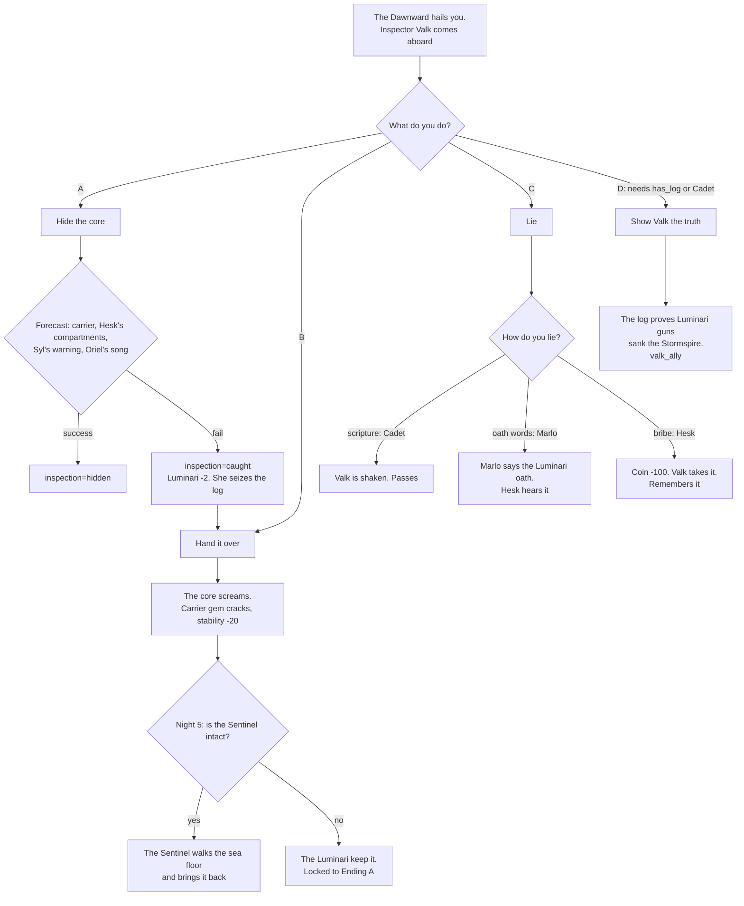
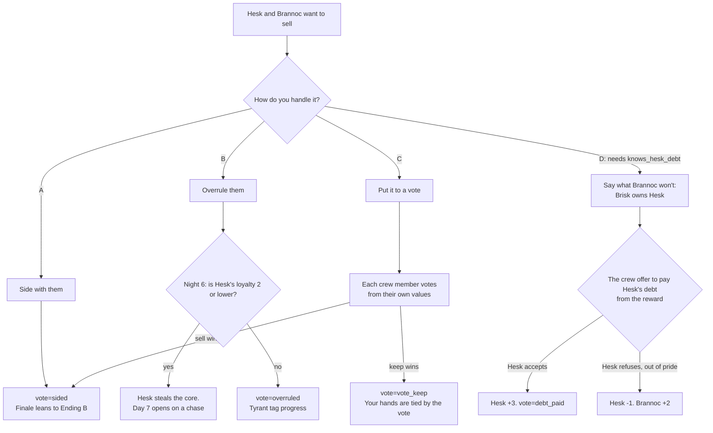
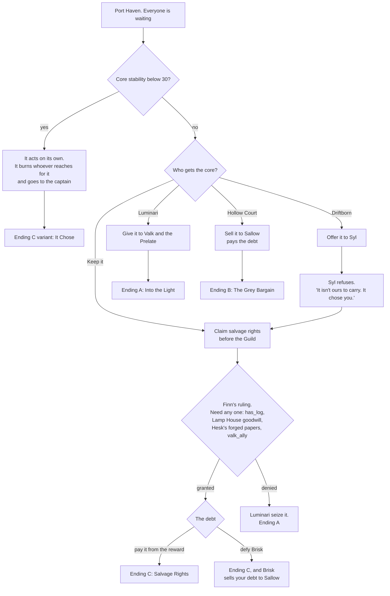

---
tags:
  - gdd
  - narrative
  - branching
  - episode-1
status: active
created: 2026-10-23
---

# Episode 1 Decision Tree — "Salvage Rights"

Every marked decision point in Episode 1, what it changes, and how the paths meet again. Story context: [[Story Bible]]. Branching model: [[Story Structure#Branching Model: Branch and Bottleneck, with Persistent State]].

**How to read this note:** each day has a diagram and a table. Diagrams show the branches. Tables show the state each option sets, who approves (**+**) and who objects (**−**). Loyalty changes are ±1 unless noted. Names in `code` are ink variables ([[Narrative Tech Plan]]).

---

## Episode Overview

The episode always reaches the day-7 finale (the **bottleneck**). What differs is who's aboard, what they know, what state the core is in, and who's waiting on the dock.

---

## State Used in Episode 1

| Variable | Values | Set on |
|---|---|---|
| `background` | `lamphouse` / `cadet` / `debt` | Prologue |
| `debt_holder` | `brisk` / `court` | Day 1 |
| `debt_amount` | 600 / 300 coin | Day 1 |
| `pact_nana` | true / false | Day 1 |
| `knows_hesk_fee`, `knows_hesk_debt` | true / false | Day 1, Dusk, Day 6 |
| `driftborn` | `towed` / `supplied` / `passed` / `stripped` | Day 2 |
| `has_runename` | `syl` / `marlo` / none | Day 2, Day 3 |
| `sentinel` | `intact` / `damaged` / `broken` | Day 3 |
| `kestrel_boarded` | true / false | Day 3 |
| `carrier` | `oriel` / `hesk` / `marlo` / `nana` / `captain` | Day 4 |
| `core_name` | player-chosen from 4 | Day 4 |
| `has_log`, `took_ring`, `lamp_rite` | true / false | Day 4 |
| `inspection` | `hidden` / `caught` / `handed` / `lied` / `truth` | Day 5 |
| `valk_ally` | true / false | Day 5 |
| `vote` | `sided` / `overruled` / `vote_sell` / `vote_keep` / `debt_paid` | Day 6 |
| `hesk_stole` | true / false | Night 6 |
| **Numbers** | Loyalty 0-10 per crew (start 5), alignment R/C/U points (start 0), core stability 0-100 (start 70), standing −3 to +3 for Luminari, Hollow Court, Driftborn (start 0) | Throughout |

---

## Prologue — "The Lamp"

No decisions apart from character creation. See [[Story Bible#9. Prologue: "The Lamp"]].

| Background | Opening effect |
|---|---|
| Lamp House | Nana +1 loyalty; Finn's goodwill (needed for one route at the finale) |
| Struck Cadet | Hesk −1 loyalty; unlocks the scripture option on day 5 |
| Bought Debt | Brannoc +1 loyalty; unlocks reading Brisk's contract on day 1 |

---

## Day 1 — "The Deal" (Port Haven)

**Dawn:** Nana Dorrit is selling the *Halyard*. Marlo has vouched for you to her, and won't say why. The price is 600 coin you don't have. A salvage contract on the Guild board, posted by an anonymous patron, pays 800 for anything lifted from **the Stormspire wreck**, which became reachable when the storm wall pulled back. Marlo goes very still when he reads it.

| Option | Sets | + | − | Later |
|---|---|---|---|---|
| **A. Brisk's loan** | `debt_holder=brisk`, `debt_amount=600` | Hesk +2 | Brannoc (stress +10; he knows Brisk) | Day 7: Brisk on the dock. If unpaid, she sells your debt to Sallow |
| **B. Sallow's advance** | `debt_holder=court`, `debt_amount=600`, Corrupted +1, Hollow Court +1 | Hesk | Marlo −2, Nana | Sallow gets *first look* at anything salvaged. Day 5: Valk knows you took Court money (Luminari −1) |
| **C. Keel-oath** | `pact_nana=true`, `debt_holder=brisk`, `debt_amount=300` | Nana +2, Marlo | Hesk (no fee for him) | Your stress links to Nana's. When she worsens, you feel it. Breaking the oath (selling the ship later) cracks her gem |

**Curiosity is free:** asking Marlo, or asking Nana why she's selling, never costs loyalty ([[Choice & Consequence#Writing Rules]]).

**Dusk 1 hooks:** Nana (bond 1): *"Keep her afloat. That's all I ask."* Hesk: buys you a drink with money he shouldn't have.

---

## Day 2 — "The Tow" (open sea)

**Dawn:** A Driftborn boat with a snapped mast. Seyra, her brother Lio, and an old listener, **Syl**. They need a tow to the Drift, which costs half a day.

| Option | Sets | + | − | Later |
|---|---|---|---|---|
| **A. Tow** | `driftborn=towed`, Driftborn +2, Unbound +1, Watch shortened to 4 hours | Marlo, Oriel | Tamsin (being made to wait), Hesk | Syl teaches Oriel the Sentinel's verse (`has_runename=syl`). Lio steals the Lamp and returns it day 5 with Syl's message: *"It's looking for this."* |
| **B. Supplies** | `driftborn=supplied`, Driftborn +1, supplies −2 days | Nana | Hesk | Day 5 dawn: Syl's warning by signal-lamp gives you one extra hour to hide the core |
| **C. Sail on** | `driftborn=passed` | Tamsin, Hesk | Marlo, Oriel | Day 5: the boat is wrecked by the *Dawnward*. Lio is alive in the water; Seyra isn't found. Pick Lio up and he's aboard for the season ([[Lineage, Pacts & Diplomacy#Diplomatic Relationships|fosterage]] rules apply) |
| **D. Strip it** | `driftborn=stripped`, Driftborn −2, Corrupted +1, supplies +2 days | Hesk +2 | Marlo −2, Oriel −2, Nana | The Driftborn won't come to the finale. Seyra remembers your face in Ep 4 |

---

## Day 3 — "The Stormspire" (the reef at the storm wall)

**Dawn:** Two wrecks on the reef: the Luminari **Stormspire**, and beside it a smaller ship with names carved into its mast. Tamsin knows them. It's the ***Kestrel***, her family's ship. Waist-deep on the reef stands the **Tidewarden Sentinel**, rune-plated and patient. Marlo's stress jumps 20.

| Option | Sets | + | − | Later |
|---|---|---|---|---|
| **A. Fight** | `sentinel=broken` (clean win) or `damaged`, Kinetics/Aegis strain +15, injury to Brannoc or Marlo | Brannoc, Hesk | Oriel, Nana | Broken: no Wakened crew in Ep 2, and the Sentinel's Heart is yours to take ([[Gear, Relics & Reliquaries#Legendary Relics]]). Brannoc's crowd-trigger fires if he wins well |
| **B. Sneak** | `sentinel=damaged`, Tamsin strain +15 | Tamsin +2, Hesk | Marlo (over-protective) | The damaged Sentinel can still be saved in Ep 2 |
| **C. Speak** | `sentinel=intact`, Unbound +1, stability +5 | Oriel +2, Nana | Hesk (wasted time) | The Sentinel recognises the captain: *"Is the lamp home?"* It can return the core on Night 5, and join in Ep 2 |
| **C via Marlo** | also `marlo_confessed_partial` | Marlo +1 (relief) | Marlo stress +10 | Marlo's Dusk opens a new topic: the Stormspire |

---

## Day 4 — "The Core" (inside the Stormspire)

**Dawn:** In the captain's cabin: a skeleton in a captain's coat, a ring on its hand, a logbook, and in a cradle of corroded brass, the core. It is already speaking to Oriel: *"Where is the lamp?"* When the captain touches it, it goes warm and quiet.

**The bones:** the Lamp rite and taking the ring are exclusive. The rite sends the body to the sea with everything on it. Taking the ring: Hesk +1, Marlo stress +25. The rite: Marlo +2, Oriel +1, and a Lattice Memory on Night 4 (a hand letting go, still too dark to see whose).

**Who carries it** (the carrier's gem starts mutating; [[Crew & Bonds#Gem Strain]]):

| Carrier | Sets | + | − | Effect |
|---|---|---|---|---|
| **Oriel** | Unbound +2 | Oriel +2 | Tamsin (worried) | The core's voice is clearest. Oriel stops sleeping. On day 5 she can sing it silent |
| **Hesk** | Corrupted +2 | Hesk +2 | Marlo, Oriel | Hesk's Entropy gem starts growing. The core starts using Hesk's phrasing. He's less sure he wants to sell it |
| **Marlo** | Radiant +2 | — | Marlo stress +20 | He holds the cargo of the ship he survived. Breaking point likely by day 6 (confession, or he throws it overboard: a recovery Watch call) |
| **Nana** | Radiant +1, Unbound +1 | Nana +2 | Oriel (she knows about the illness) | Nana's pain eases. She'll fight to keep it. Foreshadows the Lattice-wright Path |
| **You** | stability −10 | Marlo (he hates it, and understands) | Hesk | You have no gem, so it changes *you*: some narration captions are now the core speaking ([[Psyche & Trauma#The Captain's Mind]]) |

**Its name** (sets `core_name`; flavour only in Ep 1, shapes crew lines later): *Tidecaller* (Oriel's suggestion), *Cargo* (Hesk), *Little Storm* (Tamsin), *Kestrel* (only if `kestrel_boarded`; Tamsin +1).

**Dusk 4 hooks:** read the logbook (if `has_log`): the last entry is in Ilse Carrow's hand, *"Sallow has signalled them. God help the child."* Marlo's signature is on an older purification-patrol page.

---

## Day 5 — "Inspection" (the Luminari cutter *Dawnward*)

**Dawn:** The *Dawnward* hails you and sends **Inspector Seren Valk** aboard for "inspection". If `driftborn=passed`, you saw their boat's wreckage an hour ago.

| Option | Sets | + | − | Later |
|---|---|---|---|---|
| **A. Hide** | `inspection=hidden`, Unbound +1 | Hesk, Oriel | — | On failure, as **Caught**: Luminari −2, the log is taken, and Valk takes the core too (go to B) |
| **B. Hand over** | `inspection=handed`, Luminari +2, Radiant +2, stability −20 | Marlo (relief) | the carrier −2, Oriel | Sentinel intact: it returns the core at night, and Valk's report says it *walked out of a locked vault*. Sentinel not intact: **Ending A is locked** |
| **C. Lie** | `inspection=lied` | depends on method | Marlo stress +15 (oath route) | **Oath route:** Hesk now knows Marlo was Luminari navy; secret spreads ([[Character Dynamics#3. Secrets: Who Knows What]]). **Bribe:** Valk can blackmail you in Ep 2 |
| **D. Truth** | `inspection=truth`, `valk_ally=true`, Luminari −1 officially | Oriel, Nana | Hesk (you showed a Luminari your hand) | Valk lets you sail. At the finale, she argues for you. Opens her romance and the Dawn Schism thread in Ep 2 |

If `debt_holder=court`, Valk mentions it: *"Sallow's money smells of him."* (Luminari −1 on top.)

---

## Day 6 — "The Vote" (homeward)

**Dawn:** Hesk and Brannoc want to sell the core in Port Haven. Hesk wants the money. Brannoc wants Hesk's debt paid, and won't say so.

| Option | Sets | + | − | Later |
|---|---|---|---|---|
| **A. Side with them** | `vote=sided`, Corrupted +1 | Hesk +2, Brannoc +2 | Marlo, Oriel, Nana | You've promised a sale. Backing out on day 7 costs Hesk and Brannoc −3 each |
| **B. Overrule** | `vote=overruled` | Marlo | Hesk −2, Brannoc −1 | If Hesk's loyalty ≤ 2, he steals the core on Night 6 (`hesk_stole`). Day 7 opens with a Watch chase through Port Haven |
| **C. Vote** | `vote=vote_sell` or `vote_keep` | Nana, Oriel (being asked) | whoever loses | Votes are computed from each character's axes ([[Character Dynamics#4. Group Dynamics]]). You may lobby one person at Dusk 5. A tie goes to you |
| **D. Reveal the debt** | `vote=debt_paid` or Hesk refuses | Brannoc +2 | Hesk stress +20 (exposed) | Hesk accepting is the first time anyone has paid for him. His Physician Path becomes possible ([[Professions & Advancement#The Crew's Paths]]) |

**Default votes** (before relationships shift them):

| Crew | Default | Swings if |
|---|---|---|
| Marlo | Keep, and sink it | Never sell, never |
| Tamsin | Sell | Keep if `kestrel_boarded` (she wants to know what her family died for) |
| Oriel | Keep | Always keep |
| Hesk | Sell | Keep if he's the carrier and Hesk loyalty ≥ 7 |
| Brannoc | Sell | Keep if `vote=debt_paid` is offered first |
| Nana | Keep | Sell if `pact_nana` and selling saves the ship from Brisk |

**Night 6:** anyone with loyalty ≤ 2 tells you they're leaving at Port Haven. You get one Dusk scene to change their mind, so Dusk 6 is the most important Dusk of the episode.

---

## Day 7 — "Salvage Rights" (Port Haven)

**Dawn:** The dock is full. Mother Brisk wants her money. Inspector Valk, with a Luminari Prelate, wants the core. Sallow, smiling, wants the core. Syl and Seyra wait at the end of the pier (unless `driftborn=stripped`). Harbormaster Finn has convened a salvage hearing.

**Farewells happen first.** Anyone leaving goes before the hearing, with a farewell scene ([[Crew & Bonds#Losing Crew]]).

---

## Endings

| Ending | How you get it | The core | Carries into Ep 2 | Ep 2 opening |
|---|---|---|---|---|
| **A. Into the Light** | Give it to the Luminari, or lose it on day 5 with the Sentinel broken, or lose the salvage hearing | In a Luminari vault. It refuses to speak to anyone but you | Luminari +2, Radiant +2; Valk is your handler | You're summoned to the Lantern Coast as an "honoured guest" who isn't allowed to leave. The core is the reason |
| **B. The Grey Bargain** | Sell it to Sallow | In Hollow Court hands. Sallow can't make it speak. It cries for you at night, and Oriel hears it from three islands away | Debt paid, Hollow Court +2, Corrupted +2, Luminari −2 | You're wanted in Luminari waters and sail there anyway: Sallow hires you to steal the Prelate's restoration records |
| **C. Salvage Rights** | Win the hearing (any route), or the Driftborn refuse it | Yours, legally, and everyone hates that | Guild standing +1; Luminari −1, Hollow Court −1; the debt paid or sold to Sallow | You sail for the Lantern Coast yourself, to find the house that matches your Lamp's sigil |
| **C variant: It Chose** | Stability below 30 at the finale | It chooses the captain in front of every faction | As C, plus every faction now knows it's awake | As C, but hunted from the first panel |

**Flavour carried by state, in every ending:** who's still aboard; `carrier` and their gem strain; `sentinel` (intact means it joins in Ep 2); `valk_ally`; whether Lio is aboard; `pact_nana`; whether Hesk knows about Marlo; the core's alignment and `core_name`.

### Consequence Ledger Check

Per [[Choice & Consequence#Writing Rules]], Episode 1 needs at least 3 same-episode payoffs and 2 later payoffs.

| Same episode | Later |
|---|---|
| Day 2 tow → day 5 (Lamp returned, or warning, or the wreck) | Sentinel state → Ep 2 Wakened crew |
| Day 2 Syl's verse → day 3 Sentinel | `took_ring` → Ep 2 lineage reveal |
| Day 4 logbook → day 5 truth option and day 7 hearing | `valk_ally` → Ep 2 Dawn Schism and romance |
| Day 1 debt holder → day 7 dock | `kestrel_boarded` → the Vey Storm-Sextant in Sallow's hands |
| Day 6 overrule → Night 6 theft | Marlo's oath on day 5 → Marlo ↔ Hesk in Ep 2-3 |

---

## Key Dusk Scenes in Episode 1

Dusk choices are where most secrets move. Each needs the Bond rank shown ([[Crew & Bonds#Bonds (Dusk Scenes)]]).

| Crew | Bond | Available from | What you learn | Sets |
|---|---|---|---|---|
| Brannoc | 2 | Day 2 | Brisk bought Hesk's debt from his old pit-boss | `knows_hesk_debt` |
| Marlo | 2 | Day 3, if `marlo_confessed_partial` | He served on the Stormspire. He won't say more yet | Marlo stress −15 |
| Nana | 2 | Day 1 | She's ill. She's selling the ship because she's dying | Nana's secret, known |
| Oriel | 1 | Day 1 | The voice says *"the lamp comes home"*. She's afraid it means you | — |
| Tamsin | 1 | Day 3, if `kestrel_boarded` | Grief, and the empty sextant case. She asks you not to tell Marlo she's been chasing the wall | Tamsin's secret, known |
| Hesk | 2 | Day 1 | He still pays Brisk, every month, and doesn't know why he does it | `knows_hesk_debt` |

Related: [[Story Bible]] · [[Story Structure#Episode 1 — Salvage Rights]] · [[Choice & Consequence]] · [[Character Dynamics]] · [[Stormbound GDD]]
